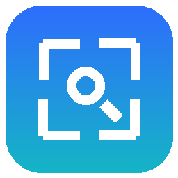
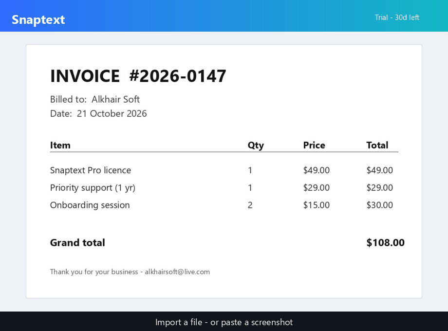

<h1 align="center">Snaptext</h1>

<b>Private, offline OCR for Windows.</b> Turn anything on your screen into text in a second, with no cloud and no account.

  <a href="https://kamidehlvi1.github.io/snaptext/">Website</a> ·
  <a href="https://github.com/kamidehlvi1/snaptext/releases/latest">Download</a> ·
  <a href="https://kamidehlvi1.github.io/snaptext/docs.html">Documentation</a> ·
  <a href="https://kamidehlvi1.github.io/snaptext/#licence">Get a licence</a> ·
  <a href="https://kamidehlvi1.github.io/snaptext/#support">Support the project</a>

## Downloads

| Download | For | Size |
|---|---|---|
| [**Snaptext-Setup.exe**](https://github.com/kamidehlvi1/snaptext/releases/latest/download/Snaptext-Setup.exe) | Everyone: screen capture, Lens, PDFs and images, tables, OMR | 146 MB |
| [**Snaptext-Handwriting-Pack.exe**](https://github.com/kamidehlvi1/snaptext/releases/latest/download/Snaptext-Handwriting-Pack.exe) | Optional free add-on: read handwriting (install after Snaptext) | 370 MB |
| [**SnapText-Rx-Setup.exe**](https://github.com/kamidehlvi1/snaptext/releases/latest/download/SnapText-Rx-Setup.exe) | Pharmacies: handwritten prescriptions into a checked medicine list | 883 MB |

User guides: [Snaptext User Guide (PDF)](downloads/Snaptext-User-Guide.pdf) · [SnapText Rx User Guide (PDF)](downloads/SnapText-Rx-User-Guide.pdf)

Windows 10 or 11, 64-bit. Everything runs on your PC, and no internet is needed after download. Check each file against `SHA256SUMS.txt` in the release.

## Features

- **Lens:** press <kbd>Ctrl</kbd>+<kbd>Alt</kbd>+<kbd>L</kbd> anywhere, draw a box, then move or resize it, and the text is read and copied.
- **Import anything:** PDFs, images and pasted screenshots into text, Markdown (tables kept) or JSON.
- **OMR:** print bubble answer sheets, then read and mark scanned sheets, with CSV export.
- **Handwriting** with the free Handwriting Pack.
- **Command line:** `snaptext region`, `window`, `file`, `watch`.
- **Private:** no network connections, no telemetry, no account.

### SnapText Rx

Reads handwritten prescriptions with two handwriting readers that check each other. It matches names to a drug list and your formulary, flags look-alike drugs, and exports only after a person confirms every line. On handwriting from other hospitals, it put the right medicine first 82% of the time. **SnapText Rx is a transcription aid, not a medical device:** a pharmacist must check every line.

## Pricing

- **Free trial:** 30 days, every feature, unlimited.
- **Free tier:** after the trial, 3 scans a day, forever.
- **Lifetime licence:** unlimited on one PC, works offline. [Request a licence](https://kamidehlvi1.github.io/snaptext/#licence) with your Machine ID.

## Support

Snaptext is built by one independent developer. A ⭐ on this repository, a share, or a [donation](https://kamidehlvi1.github.io/snaptext/#support) all help.
Questions, bugs and ideas are welcome in [Issues](https://github.com/kamidehlvi1/snaptext/issues) or by email at alkhairsoft@live.com.

---

This repository hosts the Snaptext website and release downloads. Snaptext is proprietary software. © Kamran Yousaf Dehlvi, Alkhair Soft. Snaptext OCR uses open-source components; see [third-party notices](downloads/THIRD-PARTY-NOTICES.txt).
